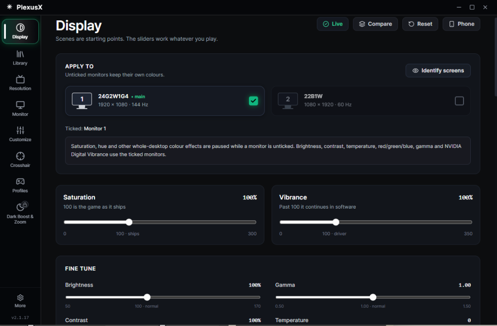

<div align="center">

# ⚡ PlexusX

**Hardware-level display vibrance, saturation up to 300%, dark boost, and pro esports crosshairs.**

[](https://github.com/ludzof/PlexusX)
[](https://github.com/ludzof/PlexusX#-anti-cheat-safe)
[](https://github.com/ludzof/PlexusX)
[](https://github.com/ludzof/PlexusX/releases/latest)
[](LICENSE)

<br/>

**[⬇️ Download Latest Release (v2.1.17 — Windows Installer & Portable)](https://github.com/ludzof/PlexusX/releases/latest)**

<br/>



<br/>
<br/>

**Spot enemies faster. Eliminate washed-out graphics. 0ms input latency.**

</div>

---

## ⚡ See the Difference

| Feature | Default Game | With PlexusX |
| :--- | :--- | :--- |
| **Saturation** | `100%` (Dull, washed-out) | **Up to 300%** (Ultra-vibrant silhouettes) |
| **Digital Vibrance** | Driver default | **Up to 350%** hardware-level gain |
| **Shadow Visibility** | Pitch black (camper advantage) | **Dark Boost** shadow equalizer |
| **Latency / FPS** | Baseline | **0ms latency · 0 FPS loss** |
| **Secondary Displays** | Blown out / glitched | **Isolated & protected** (Discord & browser stay normal) |
| **Anti-Cheat Status** | Standard | **100% External** (EAC, BattlEye, Vanguard & VAC safe) |

---

## 🚀 What PlexusX Does

<table>
  <tr>
    <td width="50%" valign="top">
      <h3>🎨 Saturation to 300%</h3>
      <p>100 is your normal picture. Go up to 300 for three times the color saturation across your whole screen to spot enemies in bushes, shadows, and smoke.</p>
    </td>
    <td width="50%" valign="top">
      <h3>🖥️ Resolution, Hz & Stretched 4:3</h3>
      <p>Instant stretched 4:3 presets (1440×1080, 1280×960) with 0ms black-screen flicker. Full HUD visibility without cropping.</p>
    </td>
  </tr>
  <tr>
    <td width="50%" valign="top">
      <h3>🎛️ Digital Vibrance</h3>
      <p>Direct NVIDIA NVAPI driver integration + high-performance software vibrance pipeline for AMD Radeon and Intel Arc graphics.</p>
    </td>
    <td width="50%" valign="top">
      <h3>🎮 Per-Game Presets</h3>
      <p>Save and auto-swap your colors for <b>Rust, CS2, Valorant, Escape from Tarkov, Apex Legends, and DayZ</b>.</p>
    </td>
  </tr>
  <tr>
    <td width="50%" valign="top">
      <h3>🎯 Pro Crosshairs & Godbridge</h3>
      <p>56+ verified presets (s1mple, NiKo, donk, TenZ, Aspas) with copyable share codes, plus Minecraft Godbridge alignment guides.</p>
    </td>
    <td width="50%" valign="top">
      <h3>🌙 Dark Boost & Hold-to-Zoom</h3>
      <p>5 shadow equalizer modes to reveal dark rooms without sky washout, plus instant hardware scope magnification (Magnifier API).</p>
    </td>
  </tr>
</table>

---

## 🖥️ Multi-Monitor Isolation

* **Isolated Gaming Display**: Only your checked gaming monitor receives saturation & vibrance enhancements.
* **Unticked Displays Stay Normal**: Secondary portrait, chat, OBS, or Discord monitors keep their factory colors.
* **Clean Auto-Restore**: Closing PlexusX automatically restores your exact default display calibration.

---

## 🛡️ Anti-Cheat Safe

PlexusX is 100% external and safe across all competitive anti-cheats (EAC, BattlEye, VAC, Vanguard, Ricochet):

* **No DLL Injection** — Never injects into game processes or hooks DirectX / Vulkan runtimes.
* **No Memory Access** — Never reads or writes any game memory addresses.
* **Native OS APIs** — Adjusts colors via Windows GDI Look-Up Tables (`SetDeviceGammaRamp`) and official NVIDIA NVAPI driver calls.
* **Click-Through Overlay** — Transparent `WS_EX_TRANSPARENT | WS_EX_LAYERED` external Windows frame.

---

## ⌨️ Global Hotkeys

| Shortcut | Action |
| :--- | :--- |
| `Alt + X` | **Toggle Crosshair** overlay on / off |
| `F8` | **Toggle Stretched 4:3** aspect ratio |
| `Mouse 5` / `Hold V` | **Hold to Zoom** (instant scope magnification) |
| `Alt + D` | **Toggle Dark Boost** night vision |

---

## ⚡ Quick Start

```bash
# Clone the repository
git clone https://github.com/ludzof/PlexusX.git
cd PlexusX

# Install dependencies
npm install

# Launch PlexusX
npm start
```

---

<div align="center">

Made for competitive gamers who demand pure visibility and performance.

</div>
