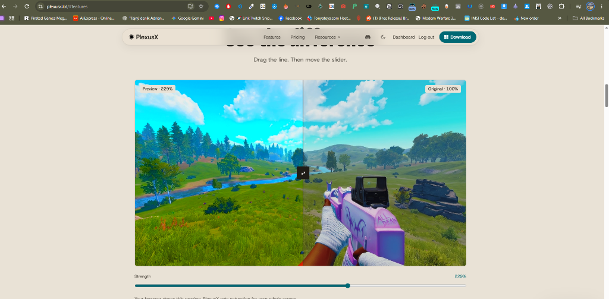
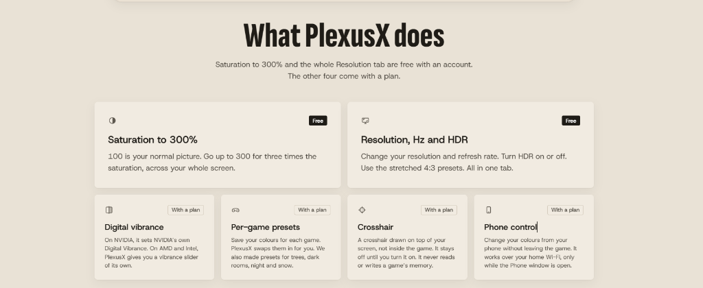

<div align="center">

# ⚡ PlexusX

### **The Competitive Gaming Display & Visibility Utility**

**Spot enemies faster. Eliminate washed-out graphics. Maximize visibility with zero input lag.**

[](https://github.com/ludzof/PlexusX)
[](https://github.com/ludzof/PlexusX#-anti-cheat-safety-guarantee)
[](https://github.com/ludzof/PlexusX)
[](LICENSE)
[](https://github.com/ludzof/PlexusX)

<br/>

**PlexusX** is an ultra-fast, hardware-accelerated desktop utility engineered for competitive FPS players (**Rust, CS2, Valorant, Escape from Tarkov, Apex Legends, DayZ, and Minecraft**). It delivers instant **300% saturation**, **350% digital vibrance**, **dark boost shadow equalization**, **esports pro crosshairs**, and **0ms stretched resolutions** — all without touching game memory or modifying game files.

<br/>

[](assets/screenshot-tool.png)
*PlexusX v2.1.17 running with live multi-monitor isolation, 300% saturation, driver-level vibrance, and hardware gamma fine-tuning.*

</div>

---

## 👁️ See the Difference

Standard monitor settings and game engines ship with muted, dull, and greyish color palettes that make targets blend into trees, shadows, and background geometry. **PlexusX completely transforms your visual clarity with zero FPS loss and 0ms latency.**

<div align="center">

[](assets/comparison-vibrance.png)
*Rust at 229% Vibrance vs 100% Factory Default — players and silhouettes pop instantly against the terrain.*

</div>

| Metric | Factory Game Display | With PlexusX Boost |
| :--- | :--- | :--- |
| **Max Saturation** | 100% (Dull, washed-out) | **Up to 300%** (Vivid, ultra-sharp contrast) |
| **Digital Vibrance** | 50–100% (GPU driver default) | **Up to 350%** (Custom high-gain curves) |
| **Shadow Visibility** | Pitch black (Campers invisible) | **Dark Boost Equalizer** (Reveals dark corners without sky blowout) |
| **Secondary Displays** | Blown out / glitched | **Isolated & Protected** (Browsers & Discord stay normal) |
| **Latency / FPS Impact** | N/A | **0ms Input Latency / 0 FPS Loss** |
| **Anti-Cheat Safety** | Standard | **100% External Win32 GDI / No DLL Injection** |

---

## ⚡ What PlexusX Does

<div align="center">

[](assets/features-overview.png)

</div>

### 1. 🎨 Saturation Up to 300% `[Included]`
* `100%` is your game as it ships. Dial up to `300%` for three times the color saturation across your entire gaming display.
* Custom luminance weighting ensures greens, blues, and reds pop without blowing out player character models.
* Coalesced real-time dispatching guarantees instant slider response without mouse micro-stutter.

### 2. 🖥️ Resolution, Hz, and Stretched 4:3 `[Included]`
* Instant hardware display mode switching with **0ms black screen flicker**.
* **Competitive Stretched Presets**:
  - `Native 16:9` (1920 × 1080 @ 144Hz+)
  - `Stretched 4:3 Pro` (1440 × 1080 @ 144Hz — **+33.3% wider hitboxes**)
  - `Low 4:3 Max FPS` (1280 × 960 @ 144Hz)
  - `Hybrid 16:10` (1680 × 1050 @ 144Hz — +11.1% wider)
  - `Ultra 5:4 Max Width` (1280 × 1024 @ 144Hz — +42.2% wider)
* **100% Screen Visibility**: True hardware scaling without window cropping — all compasses, health bars, inventory, and HUD elements remain crisp and fully in view.
* Isolated to your primary monitor (`\\.\DISPLAY1`) so secondary vertical, Discord, or chat monitors never get displaced.

### 3. 🎛️ Digital Vibrance & Hardware Gamma
* **NVIDIA Integration**: Communicates directly with the NVIDIA display driver via `NVAPI` for pure hardware-level Digital Vibrance.
* **AMD & Intel Support**: Built-in high-performance software vibrance pipeline providing the exact same vibrant experience across Radeon and Intel Arc hardware.
* **Fine-Tune Sliders**: Independent controls for **Gamma** (0.50 to 1.50), **Brightness** (50% to 170%), **Contrast**, and **Color Temperature** (blue light filter for night gaming).

### 4. 🌙 Dark Boost (Night Vision) & Instant Scope Zoom
* **Shadow Equalizer / Dark Boost**: Aggressively lifts pixel luminance in shadow regions (0%–40% luminance range) while preserving highlights to prevent daytime sky blowout.
  - **5 Spectrum Modes**: Night Green (*Classic PlexusX*), Ice Blue (*Edge separation*), Amber Gold (*Low eye-strain*), Neutral White (*Linear gamma*), and Thermal Heat-map.
  - **Invert Colors Mode**: High-contrast negative spectrum for night raids and cave navigation.
* **Hold-to-Zoom (Hardware Magnifier API)**:
  - Zero-latency hardware magnification using Windows' native `Magnification.dll` (`MagSetFullscreenTransform`).
  - Configurable keybinds (`Mouse 4`, `Mouse 5`, `Hold V`, or custom keys).
  - Smooth pixel filtering or raw sharp pixel rendering options.

### 5. 🎯 Esports Pro Crosshairs & Minecraft Godbridge Suite
* **Zero-Latency Transparent Overlay**: Topmost, click-through overlay window (`WS_EX_LAYERED | WS_EX_TRANSPARENT | WS_EX_TOPMOST`) that never modifies game memory or draws inside DirectX/Vulkan frames.
* **Official Pro Esports Presets (With Copyable In-Game Codes)**:
  - **CS2**: `s1mple`, `NiKo`, `m0NESY`, `donk`, `ZywOo`, `ropz`, `dev1ce`, `b1t`, `Twistzz`, `sh1ro`, `EliGE`, `FalleN`.
  - **Valorant**: `TenZ`, `Aspas`, `Demon1`, `Boaster`, `Derke`, `Yay`, `Shroud`, `tarik`, `Jinggg`, `Chronicle`.
* **Minecraft Godbridge & Bridging Suite**:
  - `Godbridge Arrow`: Official 45° alignment chevron pointing to the 0.5-pixel block border for backward sprint-bridging.
  - `Godbridge Delta`: Downward inverted chevron for edge block placement.
  - `Godbridge Dot-Guide`, `Telly Bridge Notch`, `Breezily Guide`, `Moonwalk Bridge`, `Andromeda Bridge`, and `W-Tap PvP Cross`.
* **Instant Search**: Type `godbridge`, `s1mple`, `tenz`, or `cs2` to filter immediately.
* **Last Used Memory**: Automatically remembers and restores your favorite crosshair with one-click restore and recent history chips.

### 6. 🎮 Per-Game Profiles & Multi-Monitor Protection
* Save custom profiles for **Rust**, **CS2**, **Valorant**, **Escape from Tarkov**, **Apex Legends**, and **DayZ**.
* **Intelligent Multi-Monitor Isolation**: Check or uncheck monitors on the fly. Secondary monitors running Discord or web browsers stay at standard desktop saturation while only your gaming monitor is boosted.
* **Original Display Restoration**: Exiting PlexusX cleanly unloads all enhancements and restores your exact factory monitor calibration automatically.

### 7. 📱 Mobile Remote Control
* Adjust display vibrance, gamma, and dark boost in real-time straight from your phone over your local Wi-Fi without alt-tabbing out of a match.

---

## 🛡️ Anti-Cheat Safety Guarantee

PlexusX is engineered from the ground up to be **100% compliant and safe across all major anti-cheat engines** (Easy Anti-Cheat, BattlEye, Valve Anti-Cheat / VAC, Vanguard, Ricochet):

```
┌────────────────────────────────────────────────────────┐
│                   HOW PLEXUSX WORKS                    │
├────────────────────────────────────────────────────────┤
│  [PlexusX Engine] ───> Win32 GDI (SetDeviceGammaRamp)  │  <-- Standard OS API
│                   ───> NVIDIA NVAPI (NvAPI_SetDVC)     │  <-- Official GPU Driver
│                   ───> Magnification.dll               │  <-- Windows System DLL
│                   ───> Layered Click-Through Overlay   │  <-- External Window
├────────────────────────────────────────────────────────┤
│  [Game Process]   <--- NEVER TOUCHED                   │  <-- 0% Memory Hooks
│                   <--- ZERO INJECTION                  │  <-- 0% DLL Hooks
│                   <--- ZERO CODE MODIFICATION          │  <-- 100% VAC / EAC Safe
└────────────────────────────────────────────────────────┘
```

* **No DLL Injection**: PlexusX never injects code or hooks DirectX/Vulkan/OpenGL runtimes.
* **No Memory Reading/Writing**: PlexusX does not inspect, read, or write any game process memory addresses.
* **Hardware-Level Display Calls**: All color adjustments operate globally on the monitor's hardware Look-Up Table (LUT) through standard Windows OS calls (`SetDeviceGammaRamp`) and NVIDIA driver APIs (`NvAPI`).

---

## 🆚 Why PlexusX?

| Feature | PlexusX | NVIDIA Control Panel | Reshade / Filters | Monitor OSD |
| :--- | :---: | :---: | :---: | :---: |
| **Saturation Range** | **0% – 300%** | Max 100% | Varies | 0% – 100% |
| **Digital Vibrance** | **0% – 350%** | Max 100% | None | None |
| **Input Latency** | **0ms (Zero)** | 0ms | +5ms to +25ms | 0ms |
| **FPS Impact** | **0 FPS Drop** | 0 FPS Drop | -10% to -25% FPS | 0 FPS Drop |
| **Anti-Cheat Safe** | **100% Safe** | 100% Safe | Often Blocked/Banned | 100% Safe |
| **Dark Boost Shadow EQ** | **5 Spectrum Modes** | Basic Brightness | Shader Hook (Blocked) | Basic Black EQ |
| **Multi-Monitor Isolation**| **Yes (Per-Screen)**| Clunky | No | Manual button clicking |
| **Instant Hotkey Scope Zoom**| **Yes (Hold-to-Zoom)**| No | No | No |
| **Esports Crosshairs & Codes**| **56+ Presets & Codes**| No | Blocked | Fixed crude dot |

---

## ⌨️ Global Hotkeys Reference

| Shortcut | Action | Description |
| :--- | :--- | :--- |
| `Alt + X` | **Toggle Crosshair** | Turn transparent crosshair overlay on / off instantly |
| `F8` | **Toggle Stretched 4:3** | Switch primary monitor between Native 16:9 and Stretched 4:3 |
| `Mouse 5` / `Hold V` | **Hold to Zoom** | Instant hardware scope magnification on crosshair |
| `Alt + D` | **Toggle Dark Boost** | Switch night vision shadow lift on / off |

---

## 🏗️ Architecture & Tech Stack

* **Frontend**: React 19, TypeScript, Vite, Tailwind CSS, Lucide Icons.
* **Desktop Runtime**: Electron 45.
* **Native Windows Engine (`PlexusEngine`)**: High-performance C# / .NET 9 daemon:
  - `SetDeviceGammaRamp` / `GetDeviceGammaRamp` for instant zero-latency gamma modification.
  - `Magnification.dll` (`MagSetFullscreenTransform`) for hardware screen magnification.
  - Bi-directional coalescing JSON-lines IPC over standard streams with exit guard cleanup.

---

## 🚀 Getting Started

### Prerequisites
* Windows 10 or Windows 11 (64-bit)
* [Node.js](https://nodejs.org/) (v18 or newer)
* [.NET 9.0 SDK](https://dotnet.microsoft.com/download/dotnet/9.0)

### Quick Run
```bash
# Clone the repository
git clone https://github.com/ludzof/PlexusX.git

# Enter project directory
cd PlexusX

# Install dependencies
npm install

# Build and start PlexusX
npm start
```

### Development Mode (Hot Reload)
```bash
npm run electron:dev
```

### Rebuild Native C# Engine
```bash
npm run engine:build
```

---

<div align="center">

**Made for competitive players who demand pure visual performance.**

[Back to top ↑](#-plexusx)

</div>
